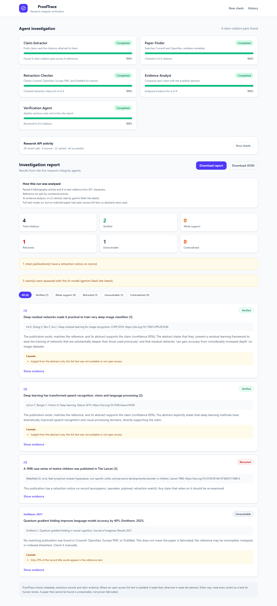
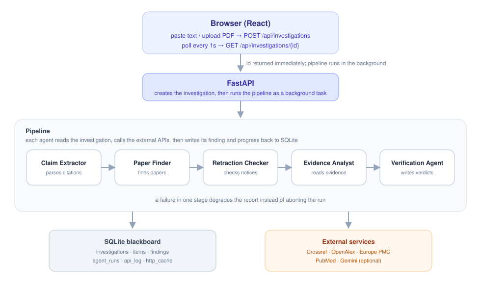

# ProofTrace

ProofTrace checks the citations in a research document. Paste text or
upload a PDF, and five agents work through it: they parse the
bibliography, look each reference up in scholarly databases, check for
retractions, compare each claim with the paper's open-access full text
(or its abstract when no full text is available), and write a cautious
verdict.

It is a research-integrity **triage** tool. Every verdict is a lead for
human review, not a final judgement, and a paper that cannot be found is
reported as *unresolvable* — never as "fabricated".



## How it works



Each agent reads the investigation from SQLite, writes its findings
back, and reports progress. The UI polls the investigation until it is
`completed`. See `docs/architecture.md` for the table schemas and the
agent contract.

## The five agents

1. **Claim Extractor** – splits the document into body and bibliography,
   strips page furniture (running heads, licence stamps, page numbers),
   parses the reference list (numbered, inline-numbered, unnumbered, or
   an AI-assisted split of an undivided blob), and associates every
   in-text citation — including narrative forms such as
   `Devlin et al. (2019)` — with its reference entry.
2. **Paper Finder** – looks each reference up in Crossref, OpenAlex,
   Europe PMC and PubMed (by DOI when present, otherwise by
   bibliographic search), validates title, authors and year, fills in an
   abstract from Europe PMC when Crossref and OpenAlex have none, and
   fetches the open-access full text when one can be found.
3. **Retraction Checker** – checks Crossref (Retraction Watch data),
   OpenAlex, Europe PMC and PubMed for retractions, expressions of
   concern and corrections, keeping corrections distinct. It also checks
   the uploaded document's own DOI when one is present.
4. **Evidence Analyst** – asks Gemini whether the source text supports
   the claim, preferring the open-access full text over the abstract. It
   labels which one it read. When Gemini is unavailable it falls back to
   keyword overlap and labels the result as a fallback.
5. **Verification Agent** – applies the verdict rules below and writes
   the report.

## Verdict rules

| Verdict          | When it is used                                                        |
|------------------|------------------------------------------------------------------------|
| `VERIFIED`       | Match is clean, the AI read the source text (full text or abstract), it supports the claim, confidence ≥ 0.65, and author and year match. |
| `WEAK SUPPORT`   | The work exists but support is partial, confidence is low, keyword fallback was used, or author/year does not match. |
| `RETRACTED`      | A retraction notice is on record for the matched work.                 |
| `CONTRADICTED`   | The abstract contradicts the claim with confidence ≥ 0.6.              |
| `UNRESOLVABLE`   | No match, an API error, only a marker with no reference, or an ambiguous author-year. |

A claim can only be `VERIFIED` when the AI actually read the source text
(`method == "llm"`). Keyword overlap tops out at `WEAK SUPPORT`. A year
mismatch downgrades the verdict, and an ambiguous citation is left
unresolved rather than guessed.

## Setup on Windows

### Backend

```powershell
cd backend
python -m venv .venv
.\.venv\Scripts\Activate.ps1
pip install -r requirements.txt
copy .env.example .env      # then fill in your keys
```

`.env` keys:

| Key                        | Purpose                                                        |
|----------------------------|----------------------------------------------------------------|
| `CONTACT_EMAIL`            | Used in the API `User-Agent` (mailto) so providers can contact you. |
| `GEMINI_API_KEY`           | Enables AI evidence analysis. Leave blank to run keyword-only. |
| `GEMINI_MODEL`             | Default `gemini-flash-lite-latest`.                            |
| `GEMINI_FALLBACK_MODELS`   | Optional comma-separated fallbacks.                            |
| `OPENALEX_API_KEY`         | Optional; polite-pool access to OpenAlex.                      |
| `DB_PATH`                  | SQLite file (default `prooftrace.db`).                         |
| `CORS_ORIGINS`             | Allowed frontend origin (default `http://localhost:5173`).     |
| `MAX_CITATIONS`            | Citations fully verified per run (default 200).                |
| `RETRACTION_CACHE_TTL_HOURS` | Retraction cache lifetime (default 6).                       |
| `FULL_TEXT_MODE`           | Read open-access full text instead of only the abstract (default `true`). |
| `MAX_FULL_TEXT_CHARS`      | Cap on stored full text per paper (default 20000).             |
| `MAX_FULLTEXT_PAGES`       | Pages extracted from an open-access PDF (default 30).          |

If the configured Gemini model has been retired, the wrapper lists the
live models and picks a working one automatically, so a stale model name
degrades to a fallback rather than silently disabling AI.

### Frontend

```powershell
cd frontend
npm install
```

## How to run

Two terminals:

```powershell
# terminal 1 — backend
cd backend
.\.venv\Scripts\Activate.ps1
uvicorn app.main:app --reload --port 8000

# terminal 2 — frontend
cd frontend
npm run dev
```

Open <http://localhost:5173>. The Vite dev server proxies `/api/*` to
the backend on port 8000.

## Working with a report

The report page can download the full run as a self-contained **HTML**
file, download the raw **JSON**, or **print / save it as a PDF** through
the browser's print dialog. If a run fails, a **Retry** button starts a
fresh investigation from the same text and keeps the failed run in your
history. A short "How this run was analysed" note is collapsed above the
citations; open it to see how many claims the AI read and whether they
were judged from the full text or the abstract.

## How to test

```powershell
# backend
cd backend ; py -m pytest -q

# frontend (single run, no watch)
cd frontend ; npm test -- --run

# frontend lint + production build
cd frontend ; npm run lint ; npm run build
```

## API endpoints

| Method | Path                        | Purpose                                                  |
|--------|-----------------------------|----------------------------------------------------------|
| `GET`  | `/api/health`               | Status: AI on/off, model, input and citation limits.     |
| `POST` | `/api/investigations`       | Queue a new investigation (`{"text": "..."}`); returns its id. |
| `GET`  | `/api/investigations`       | List recent investigations.                              |
| `GET`  | `/api/investigations/{id}`  | Status, agent progress, report and API activity.         |
| `POST` | `/api/investigations/{id}/retry` | Start a fresh run of the same text; returns the new id. |
| `POST` | `/api/extract-pdf`          | Extract text from an uploaded PDF (≤ 10 MB).             |

Interactive docs are served at `/docs`.

## Limitations

Read `docs/limitations.md`. In short:

* Verdicts are leads for human review, not final judgements.
* Evidence is judged from the open-access full text when available, and
  otherwise from the abstract; figures, tables and supplementary files
  are not read, and many papers have neither a full text nor an abstract.
* Coverage spans Crossref, OpenAlex, Europe PMC and PubMed, but is still
  incomplete; a missing record never proves fabrication.
* Retraction data depends on source freshness; absence of a notice is not
  proof of validity.
* The extractor handles common citation styles but not every format.
* AI output can be wrong, which is why quotes are verified against the
  source text and confidence is capped.
* Only the first `MAX_CITATIONS` citations per run (default 200) are
  fully verified.

## Acknowledgements

This project is the capstone submission for the **Multi-agent systems: build an AI research team** course on [Homingo Learn](https://learn.homingo.co.in/courses/multi-agent-research-team).

## License

MIT — see [LICENSE](LICENSE).
