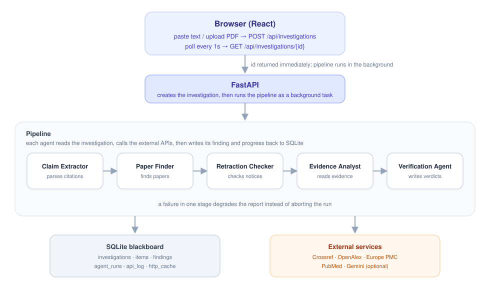
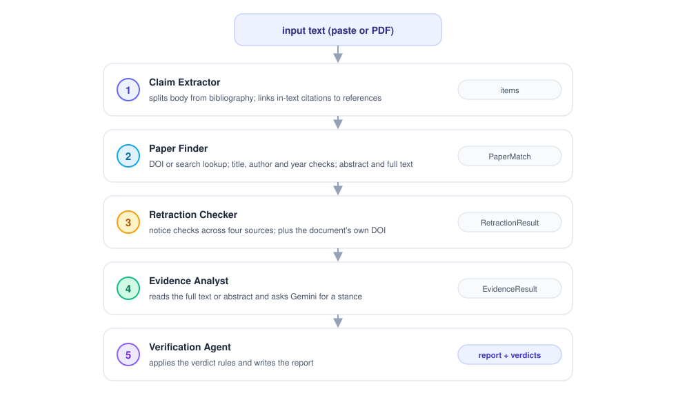

# ProofTrace architecture

## Request flow

```
GET  /api/health                -> liveness, AI availability, input caps
POST /api/investigations        -> queue investigation, run pipeline in background
GET  /api/investigations        -> list past investigations (the History view)
GET  /api/investigations/{id}   -> status, agent progress, report, API activity
POST /api/extract-pdf           -> pypdf text extraction (no bibliography truncation)
```

The pipeline is a small blackboard: each agent reads the investigation
from SQLite, writes its findings back, and reports progress.



Within the pipeline each agent hands its result to the next through
SQLite, so a failure in one stage degrades the report instead of
aborting the run:



## Storage (SQLite)

| table           | purpose                                        |
|-----------------|------------------------------------------------|
| investigations  | input text, status, final report JSON          |
| agent_runs      | per-agent status, message, progress            |
| items           | one row per distinct citation                  |
| findings        | per-agent JSON result per item                 |
| api_log         | external API calls (shown in the UI)           |
| http_cache      | cached API responses (24h TTL)                 |

## Agent contract

Each agent's `run` returns an outcome dict:

```python
{
    "notes":  ["..."],   # human-readable notes for the report
    "errors": 3,          # count of items that failed
    "failed": ["c7"],     # ids of items that failed
    "data":   {...},      # agent-specific payload
}
```

The orchestrator normalises this in `Pipeline._outcome`. An agent whose
run had zero problems is marked `completed`; otherwise
`completed_with_errors` (surfaced as **Partial** in the UI). The
investigation itself still finishes as `completed`, and the report
records `agent_errors`.

## Extraction

`app/agents/claim_extractor.py`

* `strip_page_furniture` removes lines matching known furniture
  patterns, and any line that repeats (running heads repeat per page).
  Lines containing a DOI are never treated as furniture.
* `split_sections` finds the bibliography by heading, or by the longest
  run of numbered entries in the lower half of the document.
* `split_sentences` splits the body into sentences for claim extraction.
  The full stop of a known abbreviation (`et al.`, `e.g.`, `cf.`, …) is
  protected while splitting, so a narrative citation such as
  `Devlin et al. (2019)` stays in one piece and is still matched.
* `parse_references` returns `(refs, segmentation)` and handles numbered
  entries (`[1]`, `1.`, `1)`) with wrapped continuation lines, inline
  numbered markers inside one paragraph, and unnumbered lists separated
  by blank lines or by reference-leading lines. A single undivided blob
  is sent to the AI model to split (segmentation `llm`); the method used
  is recorded in the report. A bare inline marker is limited to one to
  three digits, so a trailing four-digit year (`... NAACL 2019.`) is
  never mistaken for a list marker.
* In-text citations are scanned per sentence in five forms: bracketed
  numbers (`[1]`, `[1,3-5]`, `[1]–[3]`), parenthetical author-year
  (`(Smith, 2018)`), narrative author-year (`Devlin et al. (2019)`),
  leading DOI links, and a bare DOI. The text is read for a DOI even
  when no reference list is present.
* Each citation gets a `ref_key` so every in-text form of the same
  reference is deduplicated onto one item.
* Author-year citations are resolved in two passes: an exact
  first-author + year match, then a normalised match (accents, initials,
  small year drift). If either pass matches more than one entry the
  citation is left unresolved rather than guessed.

## Matching

`app/agents/paper_finder.py`

`norm()` produces both split tokens and a compact (punctuation-free)
form, so `multi-source` matches `multisource`; it also strips accents
and folds simple plurals. Author names are compared as whole normalised
tokens. Title coverage, year and author are checked and recorded in
`match.checks`; discrepancies are kept in `match.discrepancies`. A
resolving DOI promotes a partial title match to `matched` unless the
author or year contradicts it.

A citation is looked up by DOI when it has one, and otherwise by
bibliographic search, across Crossref, OpenAlex, Europe PMC and PubMed
in that order. The best-scoring candidate is then *enriched*:

* `abstract` is taken from Crossref, then OpenAlex, and — when neither
  carries one (common for some publishers, e.g. Nature) — from Europe
  PMC, so the claim can be judged on real text instead of being reported
  as unassessable;
* `crossref_updates` (retraction/correction notices) and the OpenAlex
  `openalex_retracted` flag are merged in for the Retraction Checker;
* when `full_text_mode` is on, the open-access full text is fetched —
  Europe PMC's structured XML first, then an OpenAlex open-access PDF.

## Evidence

`app/agents/evidence_analyst.py`

For each matched citation the analyst reads the open-access full text
when it was fetched, otherwise the abstract. If neither exists it
returns an empty `EvidenceResult` (method `none`) with a plain
limitation, and the Verdict Agent says support could not be assessed —
it never implies the paper fails to support the claim.

When text is available the model returns a `stance` of `supports`,
`partially_supports`, `neutral`, `contradicts` or `insufficient`, a
confidence, a rationale and (when it can be quoted verbatim from the
text) a `quote`. With no model available it falls back to an honest
keyword-overlap heuristic, clearly labelled `lexical`.

## Verdicts

`app/agents/verification_agent.py`

* no/weak match or API error -> `UNRESOLVABLE`
* retraction notice -> `RETRACTED`
* contradicts, confidence >= 0.6 -> `CONTRADICTED`
* supports, confidence >= 0.65, `method == "llm"`, author matches and
  year matches -> `VERIFIED`
* otherwise -> `WEAK SUPPORT`

A `WEAK SUPPORT` explanation names the actual situation rather than a
vague "does not clearly support":

* no text was evaluated (method `none`) -> "claim support could not be
  assessed", stated once;
* `partially_supports` -> "supports only part of the claim";
* `neutral` -> "does not confirm or contradict the claim";
* anything else -> "the available text did not address the claim
  directly".

## Frontend

`frontend/src`

A small React app (`App.jsx`) with three views switched by local state:
`Home` (paste text or upload a PDF), `Run` (polls the investigation and
renders `AgentCards` plus `Results`), and `History` (past runs).
`api.js` wraps the HTTP calls.

`components/ui.jsx` holds shared pieces: the `Logo`, a `FOCUS` class
giving every interactive control a keyboard `focus-visible` ring, a
`Skeleton` placeholder, and an `EmptyState` block. `Run` and `History`
show skeletons while loading and a clear empty state with a "Start a new
check" action; `Results` shows a filter-specific empty state. Progress is
only ever shown at its true value — a partially finished agent is
labelled **Partial**, never 100%.
